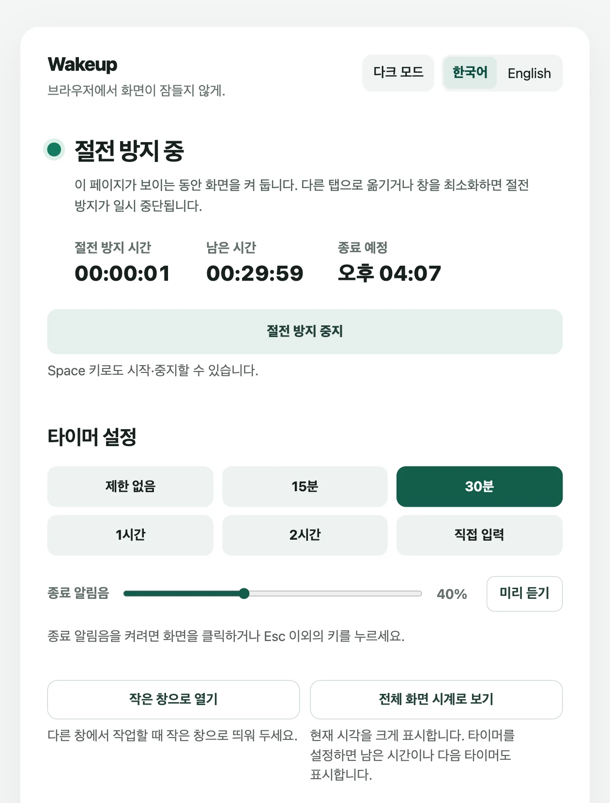

# Wakeup

Wakeup은 Windows와 macOS에서 화면이 자동으로 꺼지지 않게 해 줍니다. 설치 없이 브라우저에서 바로 쓸 수 있습니다.

**[Wakeup 열기](https://wakeup.subproject.kr/)** · [Open Wakeup in English](https://wakeup.subproject.kr/?lang=en)

## 사용 방법

1. Wakeup을 열고 **절전 방지 중**이 표시되는지 확인하세요. **절전 방지 시작** 버튼이 보이면 눌러 주세요.
2. 일정 시간만 화면을 켜 두려면 **타이머 설정**에서 시간을 고르세요. 시간이 다 되면 절전 방지가 끝납니다.
3. 직접 끄려면 **절전 방지 중지**를 누르세요.

다른 탭으로 이동하거나 창을 최소화하면 절전 방지가 일시 중단됩니다. 다른 작업을 할 때는 **작은 창으로 열기**를 눌러 Wakeup 창을 화면에 보이게 두세요. [자주 묻는 질문](https://wakeup.subproject.kr/?lang=ko#faq-title)



## 로컬 실행

Python 3가 필요합니다. 터미널에서 저장소 루트로 이동해 다음 명령을 실행합니다.

```sh
python3 -m http.server --bind 127.0.0.1 8000
```

Windows에서 Python 런처를 사용한다면 `python3` 대신 `py -3`를 입력합니다.

브라우저에서 [127.0.0.1:8000](http://127.0.0.1:8000/)을 여세요. 8000번 포트가 사용 중이면 명령과 주소의 포트 번호를 함께 바꾸세요. 서버를 끄려면 터미널에서 `Ctrl+C`를 누르세요.

제품 사양은 [기획서](docs/PLANNING.md), 개발 가이드는 [AGENTS.md](AGENTS.md)를 참고하세요.

## 라이선스

[MIT](LICENSE) © yimsemin
